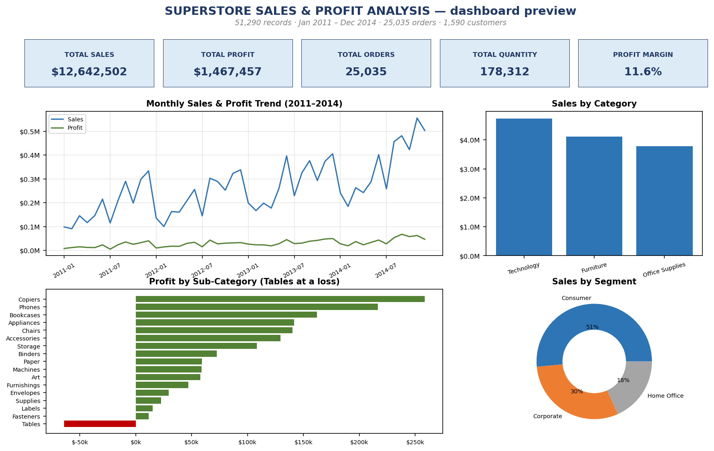

# Superstore Sales & Profit Analysis (Excel)

An end-to-end Excel data analytics project on a global superstore dataset — from raw data inspection and cleaning, through KPI engineering with Excel formulas, to a professional interactive-style dashboard. Built as a portfolio project for Data Analyst / Junior Data Analyst roles.

## Project overview

The workbook takes **51,290 order-line records (Jan 2011 – Dec 2014)** spanning 7 markets and 13 regions, and answers real business questions: where does profit come from, what destroys it, and which products, customers and segments deserve attention.

**Workbook:** `Superstore_Sales_Analysis_Completed.xlsx`

## Business objectives

1. Measure overall sales, profit and margin.
2. Find which categories, sub-categories, regions and segments drive — or drag — profit.
3. Understand monthly trends and seasonality.
4. Rank the best and worst products and customers.
5. Test the discount–profitability relationship.
6. Evaluate shipping modes and order priorities.

## Dataset

- **Source:** superstore orders dataset (order lines, one row per product per order).
- **Size:** 51,290 rows × 24 columns.
- **Period:** 1 Jan 2011 → 31 Dec 2014.
- **Columns:** Row ID, Order ID, Order Date, Ship Date, Ship Mode, Customer ID, Customer Name, Segment, City, State, Country, Postal Code, Market, Region, Product ID, Category, Sub-Category, Product Name, Sales, Quantity, Discount, Profit, Shipping Cost, Order Priority.

## Tools & Excel features used

- Excel Tables (structured data, filters), Freeze Panes, number formatting
- Formulas: `SUM`, `AVERAGE`, `ROWS`, `SUMIFS`, `COUNTIFS`, `IF`, `DATE`, `EDATE`
- Native Excel charts: line, column, horizontal bar, doughnut
- Data validation: date logic, numeric ranges, duplicate checks, text consistency

## Data cleaning methodology

All cleaning was applied in `Working-Data`; the `Raw-Dataset` sheet is preserved untouched.

| Check | Result | Action |
|---|---|---|
| Missing values | 0 nulls in 51,290 × 24 | none needed |
| Duplicate Row IDs / full rows | 0 | none needed |
| Date validity | all datetimes; no Ship Date before Order Date | none needed |
| Numeric ranges | Sales > 0, Quantity ≥ 1, Discount in [0, 0.85] | none needed |
| Negative profit | 12,544 rows (24.5%) | **retained** — legitimate discounted/loss sales, not errors |
| Text consistency | 16 Product Names with leading/trailing spaces | trimmed |
| Header consistency | `CustomerName` vs `Customer Name` | standardised to `Customer Name` |
| Postal codes | 41,296 × `Not Provided` (non-US rows) | **retained** — source limitation, not an error |

## KPIs & definitions

| KPI | Value | Definition |
|---|---|---|
| Total Sales | **$12,642,502** | `SUM(Sales)` |
| Total Profit | **$1,467,457** | `SUM(Profit)` |
| Total Quantity Sold | **178,312** | `SUM(Quantity)` |
| Total Orders | **25,035** | distinct Order IDs (verified via Remove Duplicates) |
| Total Customers | **1,590** | distinct Customer IDs |
| Average Order Value | **$505** | Total Sales ÷ Distinct Orders |
| Overall Profit Margin | **11.6%** | Total Profit ÷ Total Sales |
| Average Discount | **14.3%** | `AVERAGE(Discount)` |
| Total Shipping Cost | **$1,352,821** | `SUM(Shipping Cost)` |

## Analytical questions addressed

- Which category earns the most? → **Technology** ($4.74M sales, $664k profit, highest average line value).
- Which sub-category loses money? → **Tables is the only loss-maker** (−$64k), driven by deep discounts on big-ticket furniture (Cubify 3D printers, Bevis tables).
- Do discounts help or hurt? → They hurt past ~20%: the 0% discount band runs at **+25.3% margin**, the 51%+ band at **−111%**.
- Best / worst products? → Top by sales: high-end phones and copiers; worst by profit: Cubify CubeX 3D printers (−$8.9k).
- Best customer? → Tom Ashbrook ($35.7k sales).
- Seasonality? → Sales grew every year (2011 → 2014) with clear Nov–Dec holiday peaks.
- Segments / shipping? → Consumer leads (51% of sales); Standard Class ships ~60% of sales value.

## Dashboard features

The `Dashboard` sheet is a print-ready, one-screen BI report:

- **Title:** SUPERSTORE SALES & PROFIT ANALYSIS
- **5 KPI cards:** Total Sales, Total Profit, Total Orders, Total Quantity, Profit Margin (live-linked to Analysis)
- **7 charts:** monthly sales & profit trend (line) · sales by category · profit by sub-category (losses flagged) · sales by region · sales by segment (doughnut) · top 10 products · sales by ship mode
- All charts are native Excel charts linked to `Pivot-Data` summary tables, so they refresh when the data changes. In desktop Excel you can add slicers (Year, Region, Category, Segment) via *Insert → Slicer* on the Pivot-Data tables.



## Repository structure

```
superstore-sales-excel-analysis/
├── Superstore_Sales_Analysis_Completed.xlsx   # final workbook (this project)
├── Superstore_Working.xlsx                   # earlier working version (history)
├── README.md                                  # this file
└── screenshots/
    └── dashboard_preview.png                  # dashboard preview
```

### Workbook sheets

| Sheet | Contents |
|---|---|
| `Raw-Dataset` | untouched source data (51,290 rows) |
| `Working-Data` | cleaned table: trimmed text, consistent headers, formats, filters |
| `Analysis` | KPIs + SUMIFS/COUNTIFS summaries by category, sub-category, region, market, segment, ship mode, priority, year, month; top-10s; discount analysis |
| `Pivot-Data` | clean summary tables feeding the dashboard charts |
| `Dashboard` | KPI cards + 7 native Excel charts |
| `Documentation` | data dictionary, cleaning log, KPI definitions, methods, limitations |

## How to open & use

1. Download `Superstore_Sales_Analysis_Completed.xlsx` and open in **desktop Excel** (no macros needed).
2. Formulas recalculate automatically on open.
3. Use `Working-Data` filters to explore; `Analysis` shows every supporting calculation; `Dashboard` is set to landscape fit-to-page for printing/PDF.
4. Optional: add slicers via *Insert → Slicer* on any `Pivot-Data` table.

## Limitations & assumptions

- Native PivotTables/slicers can't be authored reliably by automation — summaries use `SUMIFS`/`COUNTIFS` equivalents and charts link to `Pivot-Data`; slicers can be added manually in one step.
- Distinct order/customer counts are verified values (Remove Duplicates): a 51k-row array distinct-count would make recalculation painfully slow.
- Postal codes are `Not Provided` for non-US rows (source limitation).
- Each row = one order line; AOV uses distinct orders.

## Future improvements

- Wire a Year/Region slicer to every dashboard chart.
- Add a Power Query refresh pipeline for new data drops.
- Returns & reason analysis (needs returns data).
- Next-quarter sales forecast from the monthly trend; customer cohort / repeat-purchase view.
